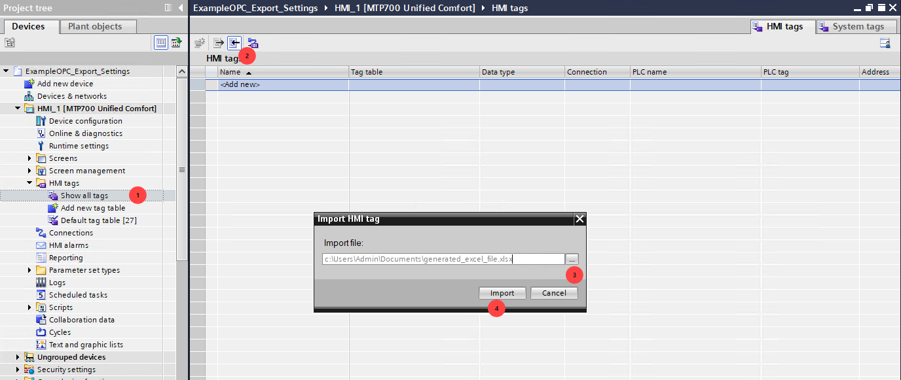
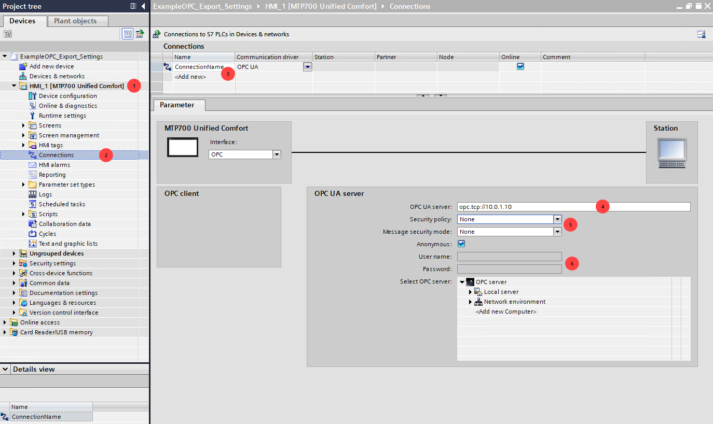

# OPC UA to TIA Portal HMI Tags

**GitHub description:** Browse OPC UA address spaces and export supported scalar variables to Siemens TIA Portal HMI tag workbooks.

Browse an OPC UA server's visible address space and export supported scalar variables to a Siemens TIA Portal HMI tag workbook. The project includes a Windows desktop GUI and a command-line interface.

The client browses metadata and reads only the attributes needed to classify variables. It does not write to the PLC or read process values. Server permissions and browse filters limit what can be discovered, so an export is not a guarantee of every variable in a controller.

## Features

- Browse from the standard `Objects` node or a supplied starting NodeId.
- Show live counts for visited nodes, variables, and eligible tags.
- Apply a limit to eligible tags, or use `0` to browse without a tag limit.
- Generate the fixed 40-column TIA HMI import workbook directly in the application.
- Run either the graphical application or the CLI.
- Remember non-secret GUI settings between executable versions in a per-user external file.
- Keep passwords and accepted server certificates in memory only for the current application session.
- Confirm and adopt a self-signed server certificate by its SHA-256 fingerprint when no trusted server certificate file is selected.
- Open project documentation or a prefilled GitHub issue directly from the GUI.

The generated TIA HMI workbook has been tested with TIA Portal V21 and:

- WinCC Unified Runtime PC
- WinCC Unified Comfort Panel

## Requirements

- Windows 10 or later for the supplied packaging script and release executable.
- Python 3.10 or later to run from source. Python 3.12 is used by the release workflow.
- An OPC UA server reachable from the computer running the application.
- A Siemens S7 OPC UA server exposing string NodeIds in the Siemens S7 namespace.
- For secure connections, the GUI automatically creates a reusable client certificate and private key. Advanced users may supply their own pair. A verified server certificate file is optional after explicit fingerprint confirmation.

Runtime dependencies are declared in `requirements.txt`: `asyncua`, `openpyxl`, and `PySide6`. Build-only dependencies, including PyInstaller, are in `requirements-build.txt`.

## Run From Source

Install the runtime dependencies and start the GUI:

```powershell
python -m pip install -r requirements.txt
python .\opc_ua_export_app.py
```

To use the CLI, inspect its options first:

```powershell
python .\opc_ua_export.py --help
```

## GUI

Fields marked with `*` are required for an export. The TIA import workbook format is fixed in the application, so there is no workbook or example-tag field. Choose an output folder; each successful run creates a timestamped `.xlsx` file there.

The GUI stores its non-secret fields in `%APPDATA%\OPC_UA_TIA_Export\settings.json`. This external per-user file is not replaced when a new executable is installed. It records the endpoint, connection name, username, security selection and certificate paths, output folder, start node, limit, and timeout. It never records the password, accepted server-certificate fingerprints, private key contents, certificate contents, or the acknowledgement for unencrypted communication. A password stays available in the GUI for later export attempts until the application is closed. Delete the JSON file to reset remembered settings.

The GUI supports these settings:

| Setting | Required or optional | Details |
| --- | --- | --- |
| OPC UA endpoint | Required | Must use `opc.tcp://`; credentials in the endpoint URL are rejected. |
| TIA HMI connection name | Required | Must already exist in the target TIA project. See [Find the HMI Connection Name](#find-the-hmi-connection-name). |
| Authentication | Required choice | Enter a username and password, or select anonymous access. |
| Channel security | Required choice | Select `Sign` or `SignAndEncrypt`, or explicitly acknowledge unencrypted communication. |
| Security policy and certificates | Required for secure mode | Uses `Basic256Sha256`. If the client certificate and private key are left empty, the application creates and reuses its OPC UA client identity in `%APPDATA%\OPC_UA_TIA_Export\client-identity`. Advanced users may select their own matching pair. A verified server certificate file is recommended. If it is omitted, the GUI displays the discovered certificate and requires explicit fingerprint confirmation before trusting it for that application session. |
| Export folder | Required | Destination for the generated workbook. |
| Starting NodeId | Optional | Defaults to `Objects`. |
| Eligible tag limit | Optional | Defaults to `100`; `0` means no limit. |
| Request timeout | Optional | Defaults to 10 seconds. |

The status pane reports browse counts and errors while the browse runs. It also shows the output file path after a workbook is created. **Open README** opens the repository documentation. **Report issue on GitHub** opens a prefilled issue containing the application version and current Status log after a privacy confirmation. Nothing is submitted until you review the form and press the GitHub submit button.


## Import in TIA Portal

1. In TIA Portal, open the target HMI and, in the `Tags` folder (1), open `All Tags` (2).
2. Click the `Import Tags` button at the top of the center screen (3).
3. Use the `Browse` button (4) to select the generated `tia_hmi_....xlsx` workbook, then click `Import` (5).
4. Keep the `Hmi Tags` worksheet selection and map/import the rows with TIA's supported HMI tag settings.
5. Confirm that the tag names, `Connection`, `Address`, and data types match the intended PLC connection.



### Find the HMI Connection Name

The exporter requires the existing HMI connection name exactly as it appears in TIA Portal. To find it, open the HMI project, inspect its device connections, and use the connection name assigned to the OPC UA endpoint. Do not use a PLC hardware name, HMI device name, or guessed placeholder; paste the exact value into the GUI or `--connection` option.

1. In TIA Portal, open the target HMI (1) and click `Connections` (2).
2. Ensure an OPC UA connection is configured, then select it (3).
3. Review the connection details (4, 5, and 6) and use them as the basic settings for the OPC UA to TIA HMI application.
4. Copy the name from the connection list (3) and use it in the application.



Before using the imported tags in production, perform a small offline import test and verify names, addresses, types, and live values in the target TIA version.

## Troubleshooting and Issue Reports

When reporting a problem, include the application version, TIA Portal version, and HMI target type. Distinguish between a WinCC Unified Runtime PC, WinCC Unified Comfort Panel, or another HMI type. If the generated workbook fails during TIA Portal import, attach TIA Portal's generated `import.xml` to the issue.

The GUI's **Report issue on GitHub** button preloads the current Status log, but you must personally review and remove endpoints, hostnames, usernames, certificate details, tag names, local paths, project information, and other sensitive data before submitting it.

## CLI

Secure connection example:

```powershell
python .\opc_ua_export.py `
  --endpoint "opc.tcp://plc.example.local:4840" `
  --user "operator" `
  --security "Basic256Sha256,SignAndEncrypt,client.der,client_key.pem,server.der" `
  --connection "HMI_Connection" `
  --limit 200
```

The password is requested interactively. The TIA workbook structure is fixed in the application and targets the Siemens S7 OPC UA namespace. CLI connections require client and server certificate files obtained or generated through a trusted process. The interactive GUI generates its own reusable client identity and can adopt a self-signed server certificate after explicit fingerprint confirmation. Protect private keys and do not commit certificates or keys to source control.

For a trusted, isolated test network where the server supports no secure endpoint, unencrypted access must be explicitly enabled:

```powershell
python .\opc_ua_export.py `
  --endpoint "opc.tcp://plc.example.local:4840" `
  --user "operator" `
  --allow-insecure `
  --connection "HMI_Connection"
```

Without `--connection`, the CLI prompts for the existing TIA connection name. Without `--user`, it prompts for a username unless `--anonymous` is selected. The endpoint may also be entered interactively. No TIA template or example-tag option is needed.

| Option | Required or optional | Description |
| --- | --- | --- |
| `--endpoint` | Optional prompt | OPC UA endpoint using the `opc.tcp` scheme. |
| `--user` / `--anonymous` | Required choice | Username is prompted when `--user` is omitted; `--anonymous` selects anonymous access. |
| `--security` / `--allow-insecure` | Required choice | Use `Basic256Sha256` with `Sign` or `SignAndEncrypt`, or explicitly allow an unencrypted channel. |
| `--connection` | Optional prompt | Existing TIA HMI connection name. |
| `--start-node` | Optional | Starting NodeId; defaults to `Objects`. |
| `--limit` | Optional | Maximum eligible tags; defaults to `100`, and `0` disables the limit. |
| `--timeout` | Optional | Per-request timeout in seconds; defaults to `10`. |

## TIA Export

The application generates the fixed TIA `Hmi Tags` worksheet and `Substitute Value Usage` worksheet directly in code. Its 40-column layout and TIA default values are based on the previously validated import format. No input workbook or example row is read. For every exported tag, the application sets the name, connection, address, and mapped data type fields.

Only scalar, readable variables with string NodeIds in the Siemens S7 OPC UA namespace and one of the supported built-in types are exported. Arrays, strings, custom types, unsupported types, and variables without confirmed read access are skipped. This is intentionally a limited HMI export, not a complete OPC UA type exporter.

| OPC UA type | TIA `DataType` | TIA `HMI DataType` | `Length` in bytes |
| --- | --- | --- | ---: |
| Boolean | Boolean | Bool | 1 |
| Int16 | Int16 | Int | 2 |
| UInt16 | UInt16 | UInt | 2 |
| Int32 | Int32 | DInt | 4 |
| UInt32 | UInt32 | UDInt | 4 |
| Float | Float | Real | 4 |
| Double | Double | LReal | 8 |

The output tag name is derived from the string NodeId identifier. Characters not accepted by TIA are replaced with underscores; the original NodeId address is preserved. If normalization creates duplicate names, the export stops rather than silently overwriting a tag.

## Security Notes

- Prefer `SignAndEncrypt` and verify the server certificate before selecting it or accepting a discovered certificate fingerprint in the GUI.
- Unencrypted OPC UA may expose credentials and traffic to other systems on the network. The CLI requires `--allow-insecure`; the GUI requires an explicit acknowledgement.
- The GUI persists non-secret configuration under `%APPDATA%\OPC_UA_TIA_Export\settings.json`, including usernames, endpoint text, and local certificate paths. It never persists passwords, accepted server-certificate fingerprints, certificate/private-key contents, or the explicit unencrypted-communication acknowledgement. Passwords and accepted fingerprints remain only in process memory until the application closes. Treat the JSON file as user configuration and protect access to the Windows profile as appropriate.
- Browsing can create load on a controller. Start with a low eligible-tag limit and coordinate with the system owner before a full browse.
- Treat generated workbooks as potentially sensitive: they contain server addresses and tag identifiers. Store and share them according to the site's data-handling rules.
- TIA connection names are copied into output but cannot be checked against the target TIA project by this application.
- This software is not a safety system and does not replace an engineering review or an offline TIA import test.

## Tests

Run the local tests with:

```powershell
python -m unittest -v test_opc_ua_export test_opc_ua_export_app test_tia_hmi_export
```

The OPC UA integration tests start a local test server. They do not connect to a production PLC.

## Build a Windows Executable

Install build dependencies and package the GUI:

```powershell
python -m pip install -r requirements-build.txt
.\build_exe.ps1
```

The result is `dist\OPC_UA_TIA_Export.exe` alongside `dist\LICENSE.md`. The executable uses `assets\branding\icon.ico` as its Windows application icon. The standalone executable includes Python and the application dependencies; users do not need a separate Python installation. No separate TIA workbook or manually supplied client certificate is needed. The GUI creates its client identity automatically when certificate fields are left empty.

The release workflow builds on a clean Windows GitHub-hosted runner with Python 3.12. To reproduce it locally, use Windows and the dependency versions in the requirements files. The first launch of a PyInstaller one-file application can take a few seconds while bundled files are extracted.

## GitHub Releases

Pushing a version tag matching `v*` runs `.github/workflows/release.yml`. The workflow runs the test suite, creates a clean Windows GUI executable, writes SHA-256 checksums, and publishes the executable, license, and checksum file to a GitHub Release. It does not package certificates, keys, or PLC export data. The executable generates the fixed Siemens S7 TIA import workbook directly. If a tag-triggered run fails and the workflow is corrected on `main`, retry it without moving the tag with `gh workflow run release.yml --ref main -f release_tag=v0.2.0`.

To create a release after reviewing and committing the source changes:

```powershell
git tag v0.2.0
git push origin v0.2.0
```

See `CHANGELOG.md` for the version history.

GitHub Actions requires `contents: write` permission for the workflow token. Release assets should be verified against the published `SHA256SUMS.txt` before use.

## Dependencies

- `asyncua`: OPC UA client and local test server.
- `openpyxl`: read and create TIA-compatible Excel workbooks.
- `PySide6`: desktop GUI.
- `PyInstaller` (build only): package the Windows executable.

## License

This project is **source-available**, not Open Source. The [Source-Available Non-Commercial Redistribution License 1.0](LICENSE.md) permits personal and professional use, plus free redistribution of original or modified versions when the license, attribution, and complete corresponding source code are included. It prohibits charging for, monetizing, bundling into paid offerings, or otherwise earning revenue from the Software or access to it. The user may sell their own products and services created with the Software when the Software itself is not the paid or distributed part of that offering.

The license applies to all published project versions, including `v0.1.0` and `v0.1.1`, their source, binaries, and release assets, unless a later release explicitly states different terms. Third-party packages remain governed by their own licenses.